# 예산 집행 관리 미니 ERP

부서별 예산을 편성하고, 직원이 집행을 신청하면 결재자가 승인·반려하는 웹 프로그램입니다.
공공기관 행정관리시스템(ERP)에서 **기준 정보(부서·예산 과목)와 집행·결재 이력이 어떻게 연결되는지**를 직접 구현해 보려고 만든 개인 프로젝트입니다.

- 개발 기간: 2026.10 ~ (진행 중)
- 개발 인원: 1명 (개인 프로젝트)

## 기술 스택

| 구분 | 사용 기술 |
|---|---|
| 언어 / 빌드 | Java 17, Maven |
| 프레임워크 | Spring Boot 4.0.x, Spring MVC |
| 화면 | Thymeleaf (서버에서 HTML을 만들어 내려주는 방식) |
| 데이터 접근 | MyBatis (SQL을 XML에 직접 작성) |
| DB | MySQL 8 |

## 주요 기능

| 화면 | 주소 | 하는 일 |
|---|---|---|
| 예산 현황 | `/budgets` | 부서 × 예산 과목별 편성액, 사용 예정액, 잔액 조회. 잔액이 편성액의 20% 미만이면 빨간색 |
| 집행 신청 | `/expenses/new` | 예산 과목, 신청자, 내용, 금액을 입력해 신청. 잔액을 넘으면 서버가 거절 |
| 결재함 | `/approvals` | 결재 대기 목록에서 승인·반려, 전체 결재 이력 조회 |
| 부서별 집행률 | `/reports` | 부서별 편성액, 집행액(승인 금액), 집행률 |

## 구조

```
화면(Thymeleaf) → Controller → Service(업무 규칙) → Mapper(MyBatis XML의 SQL) → MySQL
```

```
src/main/java/com/example/budget
 ├ controller   요청을 받아 Service를 부르고 화면에 결과를 넘김
 ├ service      업무 규칙 (잔액 검증, 권한 검사, 트랜잭션)
 ├ mapper       SQL 실행 인터페이스 (SQL은 resources/mapper/*.xml)
 ├ dto          화면·DB 사이에서 데이터를 담는 객체
 └ exception    업무 규칙 위반 예외 (BudgetException)
```

## DB 설계

테이블 6개를 **기준 정보**와 **이력 정보**로 나눴습니다.

- 기준 정보: `dept`(부서), `employee`(직원, 역할은 담당자/결재자), `budget_item`(예산 과목), `budget`(연도 × 부서 × 과목별 편성액)
- 이력 정보: `expense`(집행 신청, 상태는 대기/승인/반려), `approval_history`(결재 이력)

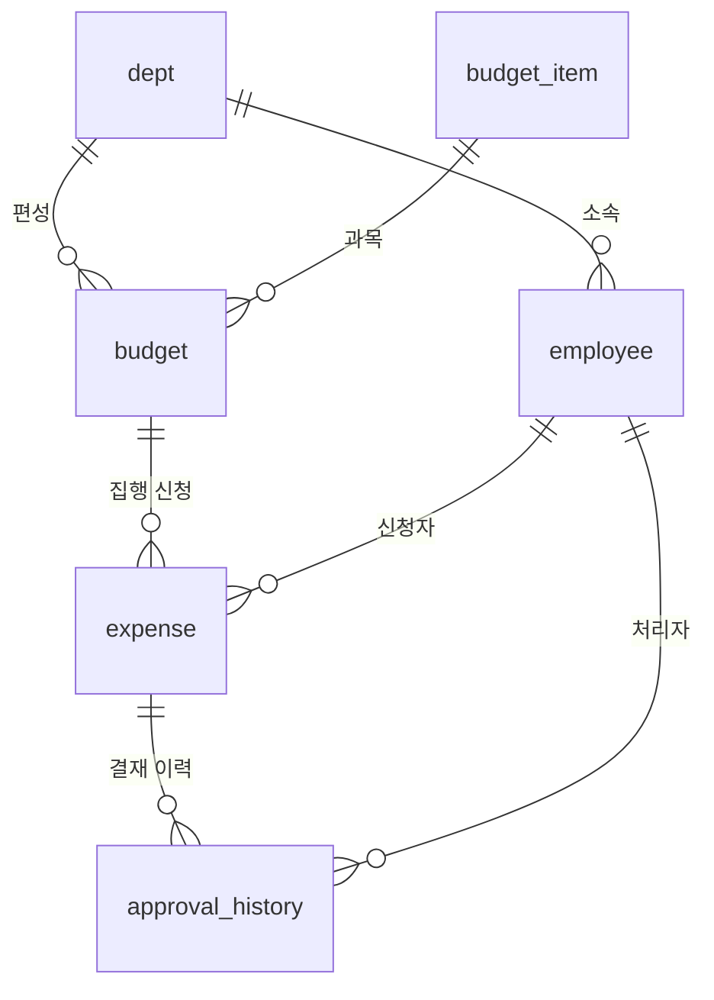

전체 DDL과 샘플 데이터, 업무 SQL은 [`db/budget_erp.sql`](db/budget_erp.sql)에 있습니다.

## 핵심 설계

**1. 잔액은 저장하지 않고 계산합니다.**
`잔액 = 편성액 − (승인 + 대기 중인 신청액)`. 결재 대기 중인 금액도 미리 빼야 같은 예산에 초과 신청을 막을 수 있습니다. 잔액을 컬럼으로 저장하지 않아서, 반려하면 별도 환불 처리 없이 잔액이 자동으로 돌아옵니다.

**2. 잔액 검증은 서버(Service)에서 합니다.**
화면에서만 막으면 요청을 직접 보내서 우회할 수 있습니다. `ExpenseService`가 입력값, 잔액을 다시 검사합니다.

**3. 신청과 이력 기록은 한 트랜잭션입니다.**
`@Transactional`로 `expense` INSERT와 `approval_history` INSERT를 묶었습니다. 중간에 예외가 나면 둘 다 취소되어, 신청만 있고 이력이 없는 데이터가 생기지 않습니다. `BudgetException`이 `RuntimeException`이라 자동으로 롤백됩니다.

**4. 같은 예산에 동시에 신청해도 초과되지 않습니다.**
잔액을 조회할 때 `SELECT ... FOR UPDATE`로 해당 예산 행을 잠가서, 같은 예산에 대한 다른 신청은 앞 신청이 끝날 때까지 기다립니다.

**5. 이미 처리된 건은 다시 처리되지 않습니다.**
`UPDATE expense SET status = ? WHERE expense_id = ? AND status = '대기'`로 대기 상태일 때만 바꾸고, 바뀐 행이 0건이면 예외를 던집니다. 두 결재자가 동시에 눌러도 먼저 처리한 한 명만 성공하고, 나머지는 이력도 남기지 않습니다.

**6. 결재 이력은 INSERT만 합니다.**
수정·삭제하지 않고 상태가 바뀔 때마다 한 줄씩 쌓아서 누가 언제 무엇을 했는지 그대로 남깁니다. 반려는 사유를 필수로 받습니다.

**7. 결재 권한도 서버에서 검사합니다.**
역할이 '결재자'이면서 신청 건이 속한 예산의 부서와 같은 부서일 때만 처리할 수 있습니다.

**8. 집행률은 집계한 뒤에 JOIN합니다.**
`expense`를 `budget`에 바로 JOIN하면 신청 건수만큼 편성액이 중복으로 더해집니다. 그래서 예산별 승인액을 먼저 `GROUP BY`로 집계한 뒤(인라인 뷰) 그 결과를 JOIN합니다.

## 화면

**예산 현황** — 사용 예정액(승인 + 대기)과 잔액을 보여 주고, 잔액이 20% 미만이면 빨간색입니다.

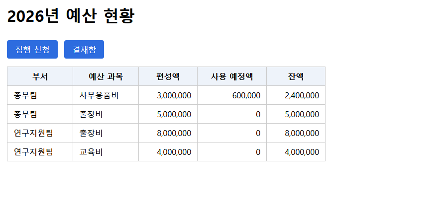

**집행 신청 — 잔액 초과는 서버가 거절** (잔액 2,400,000원에 3,000,000원 신청)

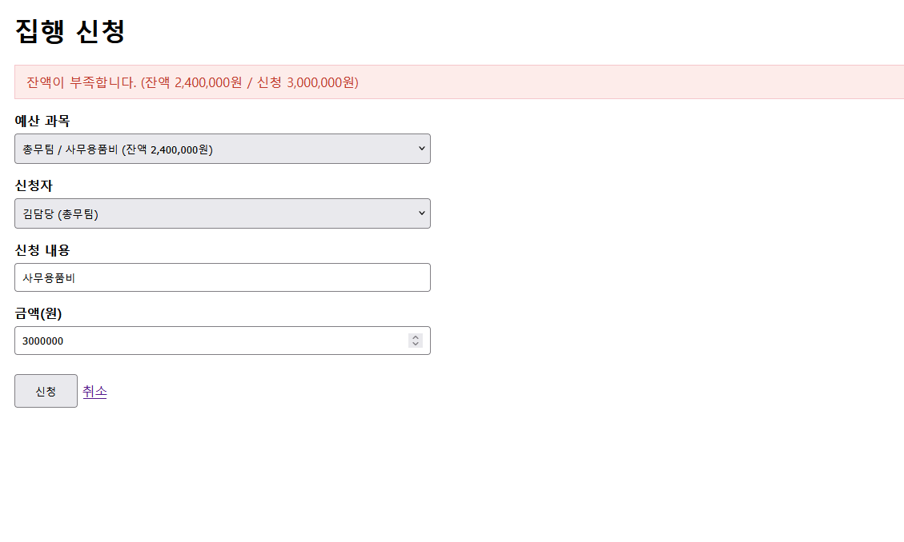

**집행 신청 — 접수** (신청이 대기 상태로 저장되고 잔액에 바로 반영)

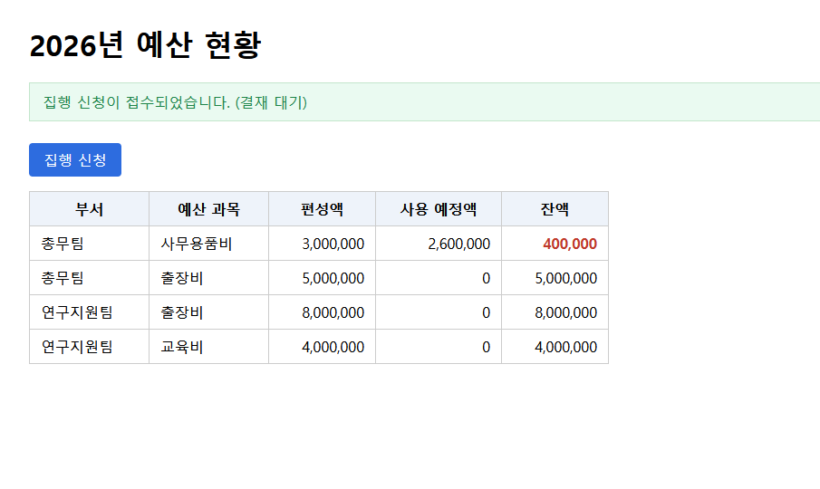

**결재 — 다른 부서 결재자는 처리할 수 없음**

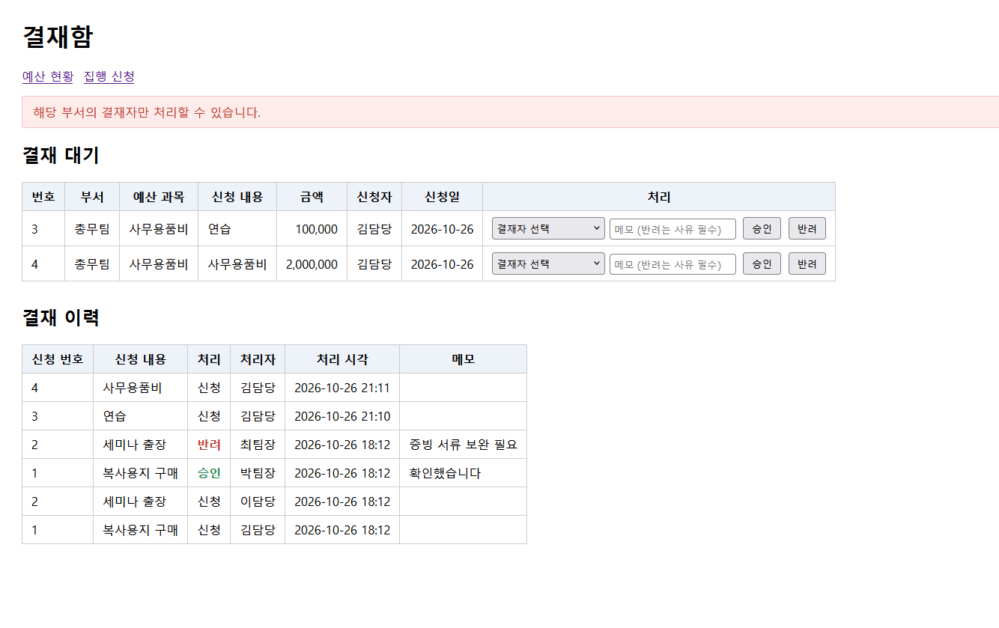

**결재 — 반려는 사유 필수**

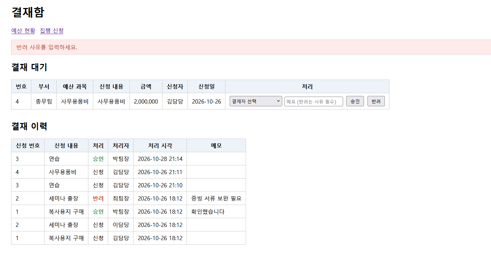

**결재 — 반려 처리 후 이력** (반려한 금액은 잔액으로 복귀)

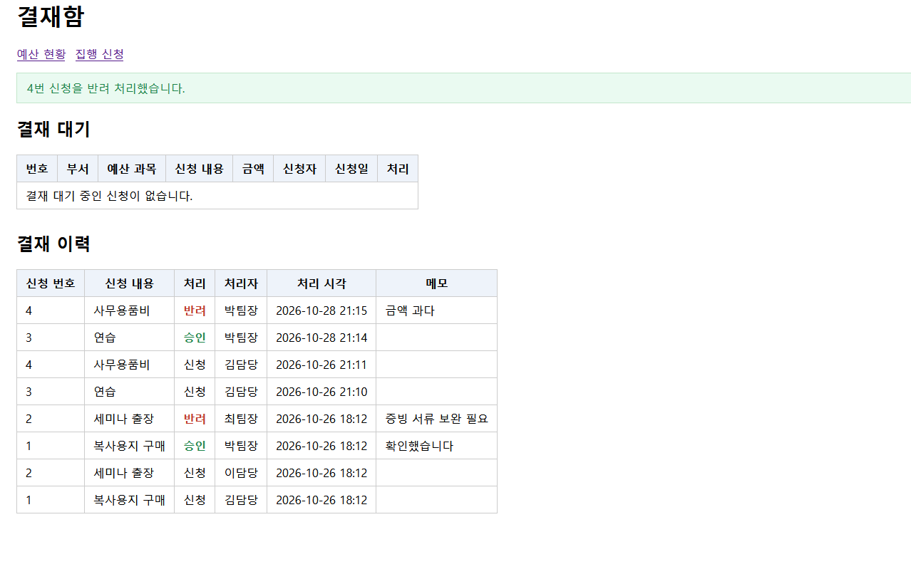

**결재 — 이미 처리된 건은 다시 처리할 수 없음** (두 탭에서 같은 건을 처리해 확인)

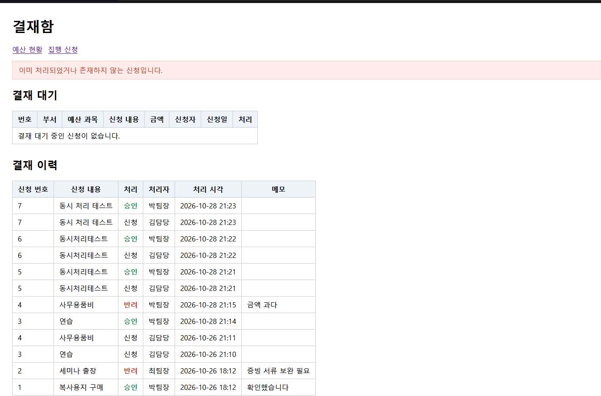

**부서별 집행률**

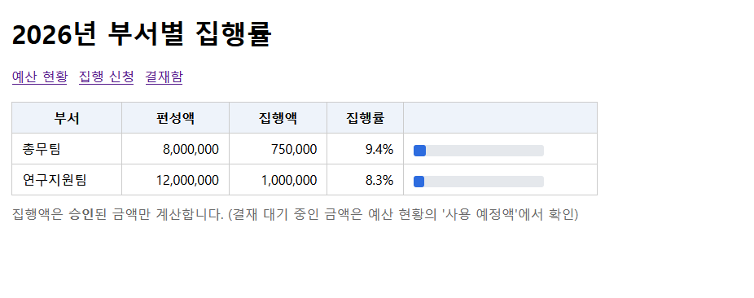

**DB에 저장된 모습** — 신청(`expense`)과 결재 이력(`approval_history`)

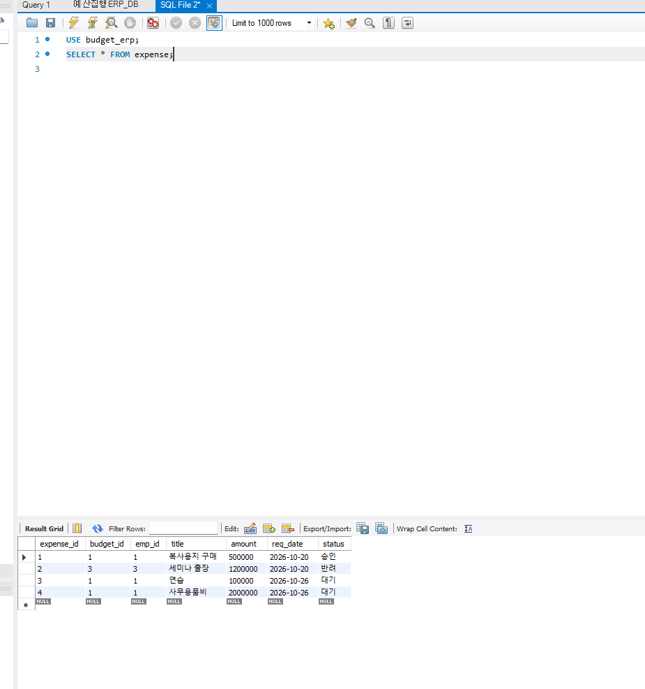
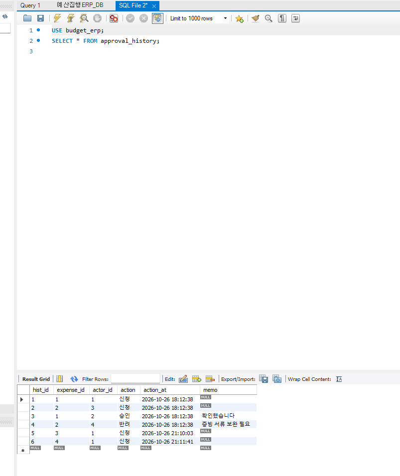

## 개발 단계

| 단계 | 내용 | 구현·확인한 것 |
|---|---|---|
| 1 | 예산 현황 조회 | Controller → Service → Mapper 흐름, 잔액 = 편성액 − (승인 + 대기) 계산 SQL |
| 2 | 집행 신청 | 서버 잔액 검증, `@Transactional`, `SELECT ... FOR UPDATE` |
| 3 | 결재함 | 승인·반려(대기일 때만 변경), 결재 이력 INSERT, 같은 부서 결재자 권한 검사 |
| 4 | 부서별 집행률 | 집계 후 JOIN하는 SQL |
| 5 | 문서화 | README, DB 스크립트, 화면 캡처 |

> 커밋 기록에서 3~4단계 코드는 두 번째 "2단계: 집행 신청..." 이름으로 남아 있습니다. 커밋 메시지를 잘못 붙인 것이고, 내용은 결재함과 집행률입니다.

## 실행 방법

1. JDK 17, MySQL 8을 설치합니다.
2. MySQL에서 [`db/budget_erp.sql`](db/budget_erp.sql)을 전체 실행합니다. `budget_erp` 데이터베이스와 샘플 데이터가 만들어집니다. (기존 `budget_erp`가 있으면 지우고 다시 만듭니다.)
3. `src/main/resources/application.properties`의 `spring.datasource.password`를 본인 MySQL 비밀번호로 바꿉니다.
4. 실행합니다.
   ```
   ./mvnw spring-boot:run
   ```
   (Windows는 `mvnw.cmd spring-boot:run`. IntelliJ에서는 `BudgetApplication`을 실행해도 됩니다.)
5. 브라우저에서 http://localhost:8080/budgets 를 엽니다.

## 한계와 앞으로 할 것

- 로그인과 인증이 없습니다. 신청자와 결재자를 화면의 선택 목록에서 고르는 방식입니다.
- 조회 연도가 2026년으로 고정되어 있습니다. (`/budgets?year=`, `/reports?year=`로는 바꿀 수 있습니다.)
- 자동화된 테스트 코드는 없고, 화면과 SQL 결과로 직접 확인했습니다.
- 현재 MySQL 기준입니다. `DATE_FORMAT` 같은 함수와 `GROUP BY`가 있는 `FOR UPDATE`는 Oracle에서는 그대로 쓸 수 없어서, 옮기려면 SQL을 바꿔야 합니다.
- 예산 편성 화면이 없어서 편성은 SQL로 넣습니다.
